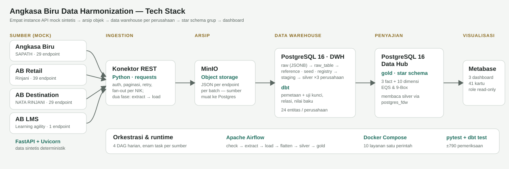
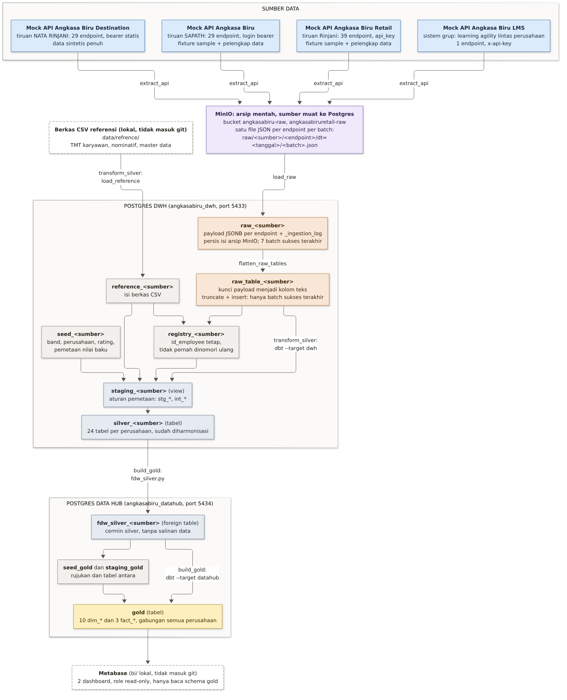
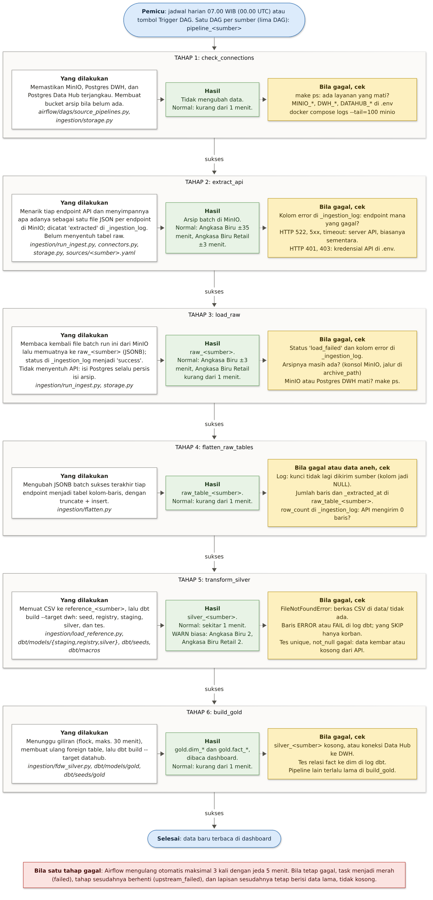
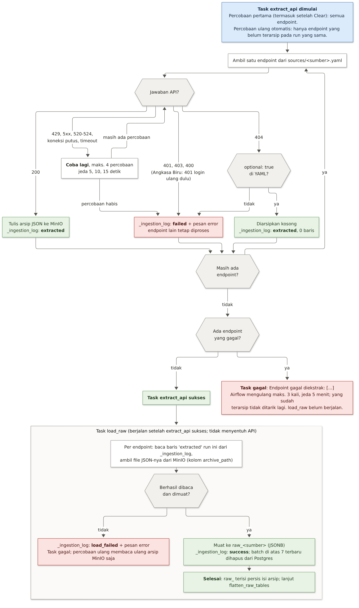
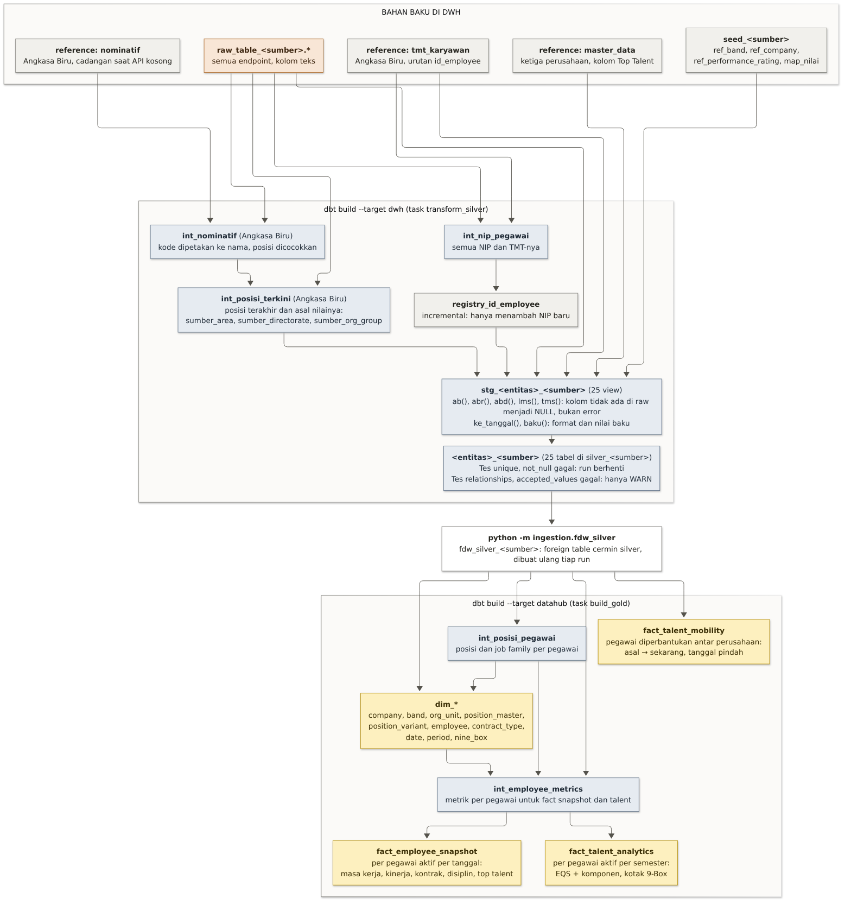
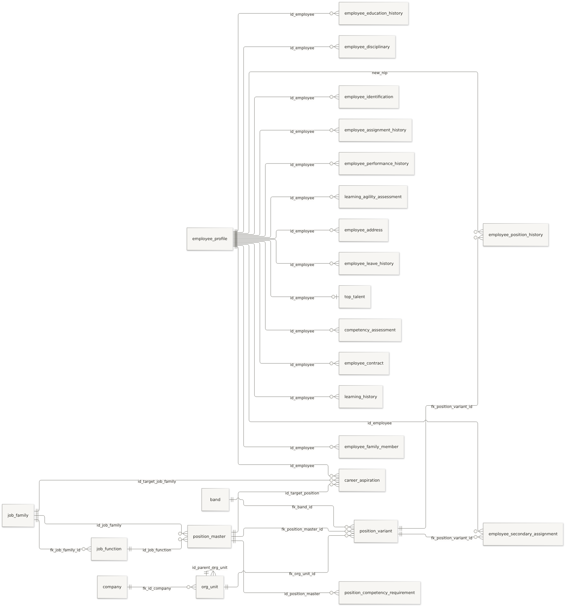
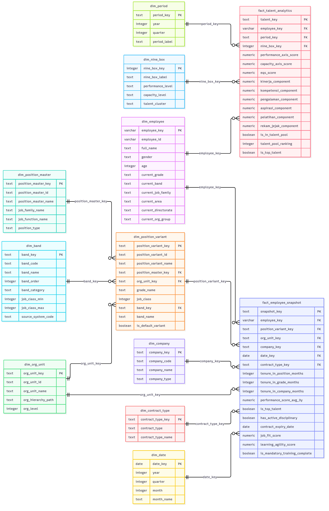
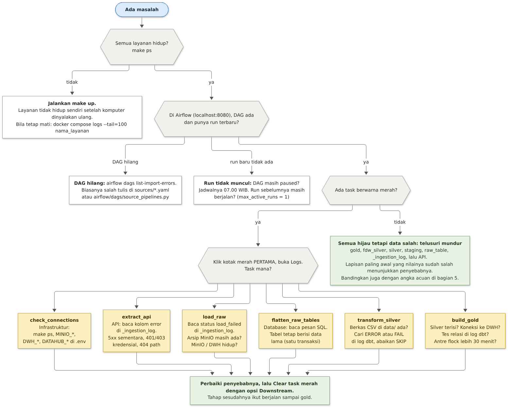

# Angkasa Biru Data Harmonization — Angkasa Biru & Angkasa Biru Retail

Pipeline multi-sumber: menarik data pegawai PT Angkasa Biru (API HRIS AB), PT Angkasa Biru Retail (API HRIS ABR), dan PT Angkasa Biru Destination (API HRIS ABD), ditambah dua sistem grup — Angkasa Biru LMS (learning agility) dan Angkasa Biru TMS (aspirasi karier) —, mengarsipkannya apa adanya di MinIO, memuatnya ke Postgres DWH,
mentransformasikannya ke layer silver per perusahaan, lalu menggabungkannya menjadi star schema gold
yang dibaca dashboard Metabase. Seluruhnya berjalan di Docker dan diorkestrasi Airflow.


## 1. Gambaran sistem

### Tech stack






Label pada panah adalah nama task Airflow yang mengerjakannya. Kotak bergaris putus-putus tidak masuk git.

### Layanan

| Layanan | Alamat | Fungsi |
|---|---|---|
| Airflow | http://localhost:8080 (`AIRFLOW_ADMIN_*` di `.env`) | Menjadwalkan dan menjalankan pipeline (harian 07.00 WIB) |
| MinIO | konsol http://localhost:9001, API port 9000 | Arsip JSON mentah; satu-satunya sumber muat ke Postgres |
| Postgres DWH | `localhost:5433`, db `angkasabiru_dwh`, user `dwh` | Layer raw, raw_table, reference, seed, registry, staging, silver |
| Postgres Data Hub | `localhost:5434`, db `angkasabiru_datahub`, user `datahub` | Layer gold (star schema) |
| Metabase | http://localhost:3000 (`METABASE_PORT`), koleksi *Angkasa Biru Data Hub* | 3 dashboard; role read-only, hanya membaca schema `gold` |
| Mock Angkasa Biru | `http://mock-angkasabiru:8000` (host: `localhost:8101`) | Instance API tiruan HRIS Angkasa Biru: bearer login + paginasi; sumber data pipeline |
| Mock Angkasa Biru Retail | `http://mock-angkasabiruretail:8000` (host: `localhost:8102`) | Instance API tiruan HRIS Angkasa Biru Retail: header `api_key`/`x-api-key`; sumber data pipeline |
| Mock Angkasa Biru Destination | `http://mock-abdestination:8000` (host: `localhost:8103`) | Instance API tiruan HRIS Angkasa Biru Destination: bearer token statis, paginasi `page`/`per_page`; sumber data pipeline |
| Mock Angkasa Biru LMS | `http://mock-lms:8000` (host: `localhost:8104`) | Sistem LMS grup: learning agility lintas perusahaan (katalog BRD 4.4), header `x-api-key` |
| Mock Angkasa Biru TMS | `http://mock-tms:8000` (host: `localhost:8105`) | Sistem talenta grup (Talent Management System): aspirasi karier lintas perusahaan (katalog BRD 5.1), header `x-api-key` |

Port host diatur lewat variabel `*_PORT` / `*_HOST_PORT` di `.env` (lihat `.env.example`); antar
container Postgres memakai `5432` dengan host `postgres-dwh` dan `postgres-datahub`. Postgres metadata
Airflow dan Metabase tidak dibuka ke host.

### Lapisan data

| Lapisan | Tempat | Diisi oleh | Aturan kunci |
|---|---|---|---|
| Arsip JSON | MinIO, bucket `<sumber>-raw` | `extract_api` | Satu file per endpoint per batch di `raw/<sumber>/<endpoint>/dt=<tanggal>/<batch>.json`; sumber muat ke Postgres sekaligus jejak apa yang persis dikirim API |
| `raw_<sumber>` | DWH | `load_raw` | Payload JSONB **dimuat dari arsip MinIO, bukan langsung dari API** + `_ingestion_log`; menyimpan `keep_batches` (7) batch sukses terakhir |
| `raw_table_<sumber>` | DWH | `flatten_raw_tables` | Kunci payload menjadi kolom teks apa adanya; truncate + insert batch sukses terakhir; kunci baru menambah kolom, kunci hilang tetap jadi kolom `NULL` |
| `reference_<sumber>` | DWH | `transform_silver` | Isi berkas CSV referensi (TMT, nominatif, master data); truncate + insert |
| `seed_<sumber>` | DWH | `transform_silver` | Rujukan buatan DWH dari `dbt/seeds/`: band, perusahaan, rating, pemetaan nilai baku |
| `registry_<sumber>` | DWH | `transform_silver` | `id_employee` buatan DWH; hanya menambah NIP baru, **tidak pernah dinomori ulang** |
| `staging_<sumber>` | DWH | `transform_silver` | View dbt berisi aturan pemetaan (`stg_*`, `int_*`); tidak menyimpan data |
| `silver_<sumber>` | DWH | `transform_silver` | 25 tabel per perusahaan (24 entitas katalog BRD + top_talent), sudah diharmonisasi; nama schema dan tabel berakhiran pemilik datanya |
| `fdw_silver_<sumber>` | Data Hub | `build_gold` | Foreign table cermin silver (tanpa salinan); dibuat ulang tiap run oleh `ingestion/fdw_silver.py` |
| `gold` | Data Hub | `build_gold` | Star schema gabungan semua perusahaan: 3 fact + 10 dimensi (katalog BRD 6.2); kunci diawali kode sumber (`AB-`, `ABR-`); baris `UNKNOWN` menjamin relasi fact selalu berpasangan |

## 2. Menjalankan

Prasyarat: Docker + Docker Compose. Nilai bawaan `.env.example` sudah berfungsi (semua sumber adalah
API mock sintetis), dan berkas referensi `data/` (lihat bagian 6) dibangkitkan otomatis oleh `make up`
bila belum ada — clone baru bisa langsung jalan tanpa menyiapkan apa pun.

```bash
cp .env.example .env            # nilai bawaan langsung jalan; ganti bila perlu
make up                         # db, MinIO, Airflow, mock API (+ bangkitkan data referensi sintetis)
make pipeline SOURCE=angkasabiru          # extract + load + flatten satu sumber
make pipeline SOURCE=angkasabiruretail    # (sumber: angkasabiru | angkasabiruretail | abdestination | lms | tms)
make pipeline SOURCE=abdestination
make pipeline SOURCE=lms
make pipeline SOURCE=tms
make silver && make gold        # transformasi silver, lalu star schema gold
make test                       # pytest (butuh stack hidup dan data raw)
```

Setelah mengubah `.env` atau `docker-compose.yml`, jalankan `make up` agar container dibuat ulang.
Masuk ke database:

```bash
docker exec -it angkasabiru-postgres-dwh psql -U dwh -d angkasabiru_dwh
```

```sql
-- apakah semua endpoint selesai pada run terakhir?
select endpoint, status, row_count, error from raw_angkasabiruretail._ingestion_log order by extracted_at desc limit 40;
-- data mentah sebagai tabel kolom-baris
select * from raw_table_angkasabiruretail.employees limit 20;
```

## 3. Tahapan pipeline

Satu DAG per file di `sources/*.yaml` — lima DAG: `pipeline_angkasabiru`, `pipeline_angkasabiruretail`,
`pipeline_abdestination`, `pipeline_lms`, `pipeline_tms` —, masing-masing enam task berurutan;
task hanya berjalan bila task sebelumnya sukses. Gagal diulang otomatis 3 kali dengan jeda 5 menit.



| Task | Yang dikerjakan | Durasi normal (AP / Angkasa Biru Retail) |
|---|---|---|
| `check_connections` | MinIO, Postgres DWH, dan Data Hub terjangkau; bucket arsip siap | < 1 menit |
| `extract_api` | Endpoint API → arsip JSON di MinIO; status `extracted` di `_ingestion_log`. Belum menyentuh Postgres | ±2–3 menit / < 1 menit (lewat mock; API asli: 21–23 menit / ±5 menit) |
| `load_raw` | Arsip batch run ini → `raw_<sumber>` (JSONB); status `success`. Tidak menyentuh API: isi Postgres persis isi arsip | ±1 menit / < 1 menit |
| `flatten_raw_tables` | JSONB batch sukses terakhir → `raw_table_<sumber>` (truncate + insert) | < 1 menit |
| `transform_silver` | Muat CSV referensi, lalu `dbt build --target dwh`: seed, registry, staging, silver + uji | ±1 menit |
| `build_gold` | `fdw_silver.py` lalu `dbt build --target datahub`; membangun gold **semua** perusahaan, dua pipeline antre lewat `flock` | < 1 menit |

Isi `extract_api` dan `load_raw` per endpoint (termasuk status `extracted`/`failed`/`load_failed` dan
perilaku percobaan ulangnya):



Tiga lapis percobaan ulang:

- **Per panggilan API** — sampai 4 percobaan berjeda 5/10/15 detik untuk error sementara
  (koneksi, timeout, 429/5xx termasuk 520–524 Cloudflare).
- **Per task** — Airflow mengulang 3×; `extract_api` hanya menarik endpoint yang belum terarsip pada run
  yang sama, `load_raw` hanya membaca ulang arsip MinIO. CLI: `--resume` / `--run-key` / `--phase`.
- **Manual** — tombol *Clear* (dengan *Downstream*) dihitung percobaan pertama: `extract_api` menarik ulang
  semua endpoint; `load_raw` hanya memuat ulang arsip run itu.

**Mode sumber** (`<SUMBER>_SOURCE_MODE` di `.env`, satu per sumber: `ANGKASABIRU_`, `ANGKASABIRURETAIL_`,
`ABDESTINATION_`, `LMS_`, `TMS_`): `live` menarik lewat HTTP
dari `*_API_BASE_URL` — sejak 15 November 2026 URL ini menunjuk instance mock; ganti ke URL asli (tersimpan
sebagai komentar di `.env`) untuk kembali ke API produksi. `sample` membaca fixture offline
`data/sample/<sumber>/*.json` langsung tanpa HTTP (PII, di luar git; segarkan dengan `make sample-refresh`) —
tanpa pelengkap data mock. Endpoint `optional: true` yang 404 diarsipkan dan dimuat kosong, bukan kegagalan.

**Variabel sumber TMS** di `.env` (pola sama dengan LMS): `TMS_SOURCE_MODE` (bawaan `live`),
`TMS_API_BASE_URL` (bawaan `http://mock-tms:8000/api`), `TMS_API_KEY` (contoh `mock-tms-key`; nilai yang sama
diteruskan ke instance mock), `TMS_MINIO_BUCKET` (bawaan `tms-raw`), dan port host `MOCK_TMS_PORT` (bawaan `8105`).

**Catatan API** — Angkasa Biru Retail: autentikasi header `api_key`/`x-api-key`; endpoint `companies` di API asli sering
HTTP 522 dan biasanya berhasil pada percobaan berikutnya. Angkasa Biru: bearer login (`POST /login`, token
di-cache, login ulang otomatis saat 401), paginasi `page`/`limit`, pembungkus respons bervariasi (ditangani
`_unwrap`), dan `getEmployeeIdentification` ditarik **per NIK** (±7.600 request) karena halaman besarnya
selalu gagal di server asli — penyebab extract API asli ±20 menit. **Instance mock meniru semua perilaku
ini** (auth, paginasi, fan-out per NIK, pembungkus ganda) dan menerima kredensial yang sama dari `.env`,
jadi konektor teruji terhadap perilaku produksi.

## 4. Transformasi dan model data

Aliran model dbt dari bahan baku sampai gold:



### 4.1 Layer raw: apa adanya dan lengkap

> Setiap endpoint API didaftarkan di `sources/<sumber>.yaml` dan diproses sampai `raw_` dan `raw_table_`,
> sesuai jumlahnya (Angkasa Biru 29, Angkasa Biru Retail 39, Angkasa Biru Destination 29, LMS 1, TMS 1 — total 99, termasuk endpoint yang hanya ada di instance mock:
> `getCompetencyAssessment` dan `competency_assessments`), tanpa dipilih-pilih. **Learning agility datang dari
> sumber sistem terpisah `lms`** (katalog BRD 4.4: sumbernya LMS, bukan HRIS per perusahaan): satu endpoint
> lintas perusahaan dengan `company_code` AB/ABR/ABD per baris; staging tiap perusahaan menyaringnya ke
> `silver_<sumber>.learning_agility_assessment_<sumber>` sehingga struktur silver dan gold tidak berubah.
> **Aspirasi karier datang dari sumber sistem `tms`** (Angkasa Biru TMS, sistem talenta grup; katalog BRD 5.1)
> dengan pola yang sama: satu endpoint `aspirations` lintas perusahaan, disaring staging tiap perusahaan ke
> `silver_<sumber>.career_aspiration_<sumber>`. Endpoint
> kosong **tetap** didaftarkan dan tabelnya dibiarkan kosong. Memilih data adalah urusan pemetaan
> transformasi, bukan layer raw.

`raw_table_` mempertahankan nama kunci persis (termasuk huruf besar seperti `CODE_AREA`), tanpa cleansing.
Struktur tabel tidak pernah di-drop, jadi view yang bergantung padanya tetap utuh dan kegagalan pengisian
tidak menghapus isi sebelumnya. Backfill manual: `make flatten SOURCE=<sumber>`.

### 4.2 Layer silver

Satu tabel per entitas katalog BRD (24 entitas: bagian 2–3 + transaksi 4.1–4.5 termasuk `learning_history`,
`learning_agility_assessment`, `competency_assessment`, `employee_secondary_assignment`, ditambah
`career_aspiration` dari bagian 5.1) + `top_talent`, **per perusahaan**, dibangun dbt. Acuan struktur:
`data_catalogue/resume/data-catalogue-2.0-sesuai-brd.html` (lokal); acuan pemetaan:
`data/refrence/mapping api to <perusahaan>.csv`. Entitas bagian 5 lainnya (eqs_score, nine_box_classification,
talent_pool, dst.) adalah keluaran Angkasa Biru TMS (inbound) dan **tidak dimuat ke core** — EQS dan 9-Box justru
dihitung DWH di gold dari rumus lampiran 7.1–7.2.



Prinsip model staging (`dbt/models/staging/<sumber>/`, makro `dbt/macros/raw_kolom.sql`):

- **Mengikuti berkas mapping, tidak menebak.** Field yang kolomnya belum dikirim API menjadi `NULL` dan
  terisi otomatis begitu kolomnya muncul di `raw_table_`. Nama kolom yang berbeda ditangani sebagai kandidat
  eksplisit (mis. `employee_status`, `nik_new`, salah ketik API `id_emloyee`).
- **Konversi tipe aman**: tanggal/angka tidak valid menjadi `NULL`; stempel waktu ISO UTC dikonversi ke
  tanggal WIB; tanggal placeholder ≤ 1900 menjadi `NULL`.
- **Kunci pegawai `id_employee`** buatan DWH, VARCHAR 8 digit: awalan perusahaan (Angkasa Biru `10`, Angkasa Biru Retail `20`, Angkasa Biru Destination `30`) +
  enam digit urut menurut tahun/tanggal masuk (TMT paling awal bernomor terkecil). Disimpan di `registry_<sumber>` dan tidak pernah berubah;
  `--full-refresh` tidak menomori ulang. `id_employee` dan `old_nip` adalah kolom berbeda dan tidak boleh
  pernah dicocokkan satu sama lain. Angkasa Biru Retail dikunci pada NIP lama (`old_nip`; `new_nip` disamakan), karena endpoint lama dan baru
  memakai dua nomor pegawai berbeda.
- **Berkas referensi** (`data/`, dimuat `ingestion/load_reference.py`): TMT karyawan (urutan `id_employee`,
  `dt_birth`, `dt_appointed_employee` AP), nominatif (pengayaan, tabel di bawah), master data (top talent;
  hanya baris perusahaan terkait dan kolom `NIK` + `Top Talent` yang dimuat — sisanya PII perusahaan lain).
- **Field dari posisi terkini AP** (`int_posisi_terkini_angkasabiru`): `job_class`, `directorate_name`,
  `org_group_name`, `area_name` diisi dari varian posisi terakhir; pegawai tanpa varian memakai aturan
  cadangan berbasis nama posisi yang terukur akurasinya; kolom `sumber_*` mencatat aturan mana yang mengisi.
- **Kolom teknis** di setiap tabel: `dwh_source_system`, `dwh_batch_id`, `dwh_extracted_at`, `dwh_loaded_at`.

**Pengayaan nominatif AP** (`Data Pegawai 08092026 - Nominatif.csv`, bersifat history — **hanya mengisi yang
kosong dari API**, tidak pernah menimpa):

| Kolom silver | Cara mengisi saat API kosong |
|---|---|
| `employee_profile.area_name` | `Area` (kode bandara) → `branches.NAME_ALIAS` → `NAME_AREA` |
| `employee_profile.directorate_name` | `Direktorat` → `directorates.name_directorat` |
| `employee_position_history.fk_position_variant_id` | Baris terakhir: nama jabatan + area + unit → varian posisi, bila kandidat tepat satu **dan** nama jabatan API sama (uji: 99,4% benar) |
| `employee_position_history.org_unit_name` | Baris terakhir: `Unit`, bila nama jabatan API sama |
| `employee_profile.org_group_name` | Group dari posisi hasil pencocokan (bukan dari `Unit`, tingkatnya berbeda) |

**Harmonisasi antar perusahaan** (diuji `tests/test_harmonisasi.py`): field yang sama bertipe, berformat,
dan bernilai baku sama. Pemetaan nilai di seed `map_nilai_<sumber>.csv` (makro `baku()`); nilai baru dari API
lolos apa adanya dan muncul sebagai WARN `accepted_values` — tinggal tambah barisnya. Format: penanda kosong
(`-`, `null`, `n/a`, …) → NULL; nama huruf besar; email huruf kecil; NPWP digit; ponsel berawalan 08.

**Band selaras lintas perusahaan** (sejak 09 November 2026) dari rentang `job_class` (seed `ref_band_<sumber>`):

| Band | Angkasa Biru | Angkasa Biru Retail | Angkasa Biru Destination | Kategori |
|---|---|---|---|---|
| Band 1 (BOD-1) | 18–23 | 17 ke atas | 17 ke atas | Executive |
| Band 2 (BOD-2) | 16–17 | 14–16 | 14–16 | Senior Managerial |
| Band 3 (BOD-3) | 14–15 | 12–13 | 12–13 | Managerial |
| Band 4 (BOD-4) | 7–13 | 7–11 | 7–11 | Operational |

Nama band kini sama antar perusahaan, jadi rujukan ke band selalu memakai pasangan (sumber, nama band).

**Top talent**: `silver_<sumber>.top_talent_<sumber>` (bukan entitas katalog) dari kolom `Top Talent`
master data — `Ya` = true; `Tidak`, kosong, atau tidak terdaftar = false. Bukan dihitung DWH.

### 4.3 Layer gold

Star schema gabungan di Data Hub, sesuai katalog BRD 6.2: **3 fact + 10 dimensi** (`fact_employee_snapshot`,
`fact_talent_analytics`, `fact_talent_mobility` — pegawai diperbantukan antar perusahaan grup;
`dim_employee`, `dim_position_master`, `dim_position_variant`, `dim_band`,
`dim_org_unit`, `dim_company`, `dim_contract_type`, `dim_date`, `dim_period`, `dim_nine_box`).



- **Gold tidak dipisah per perusahaan**: fact membawa `company_key`; kunci unit/posisi diawali `AB-`/`ABR-`.
- **Varian bawaan** (`is_default_variant`): master posisi Angkasa Biru Retail tanpa varian dibuatkan satu varian, karena
  riwayat posisinya merujuk kode master.
- **Riwayat fact dipertahankan**: `fact_employee_snapshot` per tanggal (run di tanggal yang sama menimpa
  baris tanggal itu saja), `fact_talent_analytics` per periode semester (`period_key`, mis. `2026-S2`).
- **EQS dan 9-Box dihitung DWH** (lampiran katalog 7.1–7.2), dihidupkan kembali 15 November 2026 setelah
  masukannya dilengkapi instance mock. Komponen EQS: kinerja 25% (rata-rata 3 tahun, dinormalkan per
  sumber: AP skala 0–120, Angkasa Biru Retail 0–5), kompetensi/job fit 20%, pengalaman 15% (masa kerja di job family
  yang sama, 10 tahun = 100), aspirasi 30% (terisi sejak 21 November 2026 dari `career_aspiration` Angkasa Biru
  TMS: komposit empat sumber aspirasi berbobot individual 20, supervisor 20, job holder 30, unit 30 —
  dijumlahkan per posisi target, lalu diambil target bernilai tertinggi; pegawai tanpa aspirasi = 0),
  pelatihan 10% (completion rate pelatihan wajib), rekam jejak 5% (0 bila ada disiplin aktif).
  Keenam komponen kini terisi; `eqs_score` = rata-rata tertimbang komponen yang tersedia (bobot dinormalkan
  ulang bila ada yang kosong). Sumbu 9-Box:
  performance = 95% kinerja + 5% rekam jejak; capacity = 80% job fit + 20% learning agility; tingkat
  < 60 Low, 60–79 Medium, ≥ 80 High; tanpa data masuk `nine_box_key` 0 (Unclassified).
- `fact_employee_snapshot` kini juga membawa `job_fit_score`, `learning_agility_score`, dan
  `is_mandatory_training_complete` (katalog BRD 6.2).
- **Talent Mobility dikenali lewat identitas**, bukan `employment_type`: `fact_talent_mobility` mencocokkan
  orang yang sama (`id_nik` identik) di dua perusahaan — baris non-aktif adalah perusahaan asal, baris aktif
  perusahaan sekarang; `id_nik` tidak ikut dipublikasikan. API Angkasa Biru hanya mengirim `employment_type`
  `PKWTT` dan `PKWT` (pegawai Talent Mobility berstatus `PKWTT`).

Sumber baru ikut masuk gold dengan menambahkannya di `vars.gold_sources` (`dbt/dbt_project.yml`).

## 5. Dashboard Metabase

`make dashboard` (idempoten; memakai `bi/` yang **hanya lokal**) membuat role read-only, koneksi database,
dan tiga dashboard di koleksi *Angkasa Biru Data Hub*. Kartu yang dihapus dari `bi/dashboards.py` ikut diarsipkan.

| Dashboard | Isi |
|---|---|
| Gold · Tenaga Kerja | Profil pegawai aktif: jenjang, top talent, umur, masa kerja, kontrak, sebaran organisasi, kelengkapan data per perusahaan |
| Gold · Organisasi & Posisi | Unit organisasi per level, posisi master/varian, unit dengan pegawai terbanyak |
| Gold · Talenta | Analitik `fact_talent_analytics` periode berjalan: EQS (rata-rata, distribusi, per band, top talent vs lainnya), rata-rata komponen EQS, kisi 9-Box beserta komposisi klaster per perusahaan; Talent Mobility (`fact_talent_mobility`): jumlah, rute asal → sekarang, rekap masuk/keluar per perusahaan |

Keduanya punya filter Perusahaan dan membaca snapshot terakhir. Perbandingan antarperusahaan memakai persen
(ukurannya berbeda jauh). Seluruh nama pegawai di `gold.dim_employee` adalah data sintetis, bukan orang
sungguhan.

## 6. Struktur repositori

Yang masuk git hanya yang langsung terlibat dalam ingestion, transformasi, dan modeling, ditambah yang
diperlukan untuk menjalankan, menguji, dan menjelaskannya:

| Folder / file | Fungsi |
|---|---|
| `sources/` | Definisi sumber: endpoint, autentikasi, jadwal, mode, berkas referensi |
| `ingestion/` | `run_ingest` (dua fase: extract API → MinIO, load MinIO → raw), `flatten`, `load_reference`, `fdw_silver`, konektor, loader |
| `airflow/dags/` | Generator DAG: enam task, jadwal, percobaan ulang. Menambah sumber = menambah YAML; salah tulis satu YAML menggagalkan semua DAG |
| `dbt/` | Seed, macro, model `staging/<sumber>/`, `registry/`, `silver/<sumber>/`, `gold/`, beserta uji datanya |
| `db/` | Init schema DWH dan Data Hub (hanya berlaku saat volume database pertama dibuat) |
| `scripts/dbt*` | Pembungkus dbt di dalam image (`dbt-dwh`, `dbt-datahub`) |
| `tests/` | pytest: ingestion, raw_table, silver, harmonisasi, gold, struktur DAG |
| `mock_api/` | Instance API tiruan (FastAPI): `app.py` meniru perilaku API asli, `bangun_data.py` memuat fixture + melengkapi data yang tidak ada di API asli (deterministik) |
| `docs/` | Diagram proses (Mermaid + PNG) yang dipakai README ini; cara render ulang di `docs/diagrams/README.md` |
| Akar | `Dockerfile` (image tunggal Airflow+dbt+pytest), `docker-compose.yml`, `Makefile`, `requirements*.txt`, `pytest.ini`, `.env.example` |

**Hanya lokal** (di `.gitignore`) — di komputer baru dibuat ulang otomatis atau disalin sendiri:

| Item | Isi | Bila tidak ada |
|---|---|---|
| `.env` | Kredensial API, database, MinIO, port — `cp .env.example .env` sudah cukup (nilai bawaan berfungsi untuk stack mock) | Koneksi dan penarikan API gagal |
| `data/refrence/*.csv` | CSV referensi **sintetis** (TMT, nominatif, master data) — dibangkitkan otomatis oleh `make up` bila belum ada, atau manual: `make data` | `transform_silver` gagal `FileNotFoundError` (lalu dibangkitkan otomatis saat `make silver`) |
| `data/sample/` | Fixture mode offline, **sintetis** — ikut dibangkitkan `make data` | Mode `live` (mock) tidak terpengaruh |
| `bi/`, `tests/test_metabase.py` | Definisi dan penyediaan dashboard | Dashboard yang ada tetap jalan, tak bisa dibuat ulang |
| `scripts/catalogue/`, `scripts/*.py` lain | Pembangkit dokumen katalog dan data contoh | Pipeline tetap jalan |
| `data_catalogue/`, `brd/`, `deliverable/`, `arsip/` | Dokumen, katalog, arsip (berisi contoh nilai asli) | Pipeline tetap jalan |

**Menambah sumber baru**: (1) tambah `sources/<nama>.yaml` — DAG `pipeline_<nama>` terbentuk otomatis dan
layer raw langsung jalan; (2) tambah schema `raw_<nama>`/`raw_table_<nama>` di `db/dwh/init/01_schemas.sql`
dan teruskan env-nya di `docker-compose.yml`, lalu `make up`; (3) untuk silver: sediakan berkas mapping,
tulis model `staging/`, `silver/`, `registry/`, seed `ref_*`, daftarkan schema-nya di `dbt_project.yml`,
dan tambahkan blok `dbt:` di YAML sumber; (4) untuk gold: daftarkan di `vars.gold_sources`.

## 7. Pengujian dan saat ada masalah

`make test` menjalankan ±365 pemeriksaan pytest terhadap data terpasang (butuh stack hidup). dbt juga
menguji dirinya saat `transform_silver`/`build_gold`: uji kunci (`unique`, `not_null`) menggagalkan run,
uji relasi/nilai berstatus WARN. Dengan data sintetis yang konsisten penuh, kondisi normalnya 0 WARN
(saat memakai API asli dulu ada 4-5 WARN bawaan kualitas sumber).

### Penanganan error

Prinsipnya: data di warehouse tidak pernah setengah jadi. Bila sebuah run gagal, Postgres tetap berisi
hasil run sukses sebelumnya, dan data baru yang sempat terambil hanya tertahan di arsip MinIO sampai
run-nya berhasil.

- **Satu endpoint = semua atau tidak sama sekali.** Konektor menarik satu endpoint sampai tuntas di
  memori (semua halaman, atau semua NIK untuk endpoint fan-out) baru menulisnya sebagai satu file ke
  MinIO. Galat di tengah (mis. halaman 5 dari 10) berarti tidak ada file yang ditulis, dan statusnya
  tercatat `failed` beserta pesannya di `raw_<sumber>._ingestion_log`.
- **Antar endpoint tidak saling menghentikan.** Endpoint lain tetap ditarik dan diarsipkan; task
  `extract_api` baru dinyatakan gagal setelah semuanya dicoba, bila ada satu saja yang gagal.
- **Percobaan ulang berlapis.** Konektor mengulang galat sementara (koneksi putus, timeout, galat
  server) beberapa kali dengan jeda bertambah (`retries`, `retry_backoff_seconds` di YAML sumber).
  Airflow mengulang task sampai 3 kali dengan jeda 5 menit, dan percobaan ulang hanya menarik endpoint
  yang belum terarsip pada run itu, bukan mengulang semuanya.
- **Status tiap endpoint** di `_ingestion_log`: `failed` (ekstraksi gagal, tidak ada arsip),
  `extracted` (sudah di MinIO, belum dimuat), `load_failed` (arsip ada, muat ke Postgres gagal),
  `success`.

Bila task tetap gagal setelah semua percobaan:

| Gagal di task | Yang terjadi pada data |
|---|---|
| `extract_api` | Task berikutnya tidak dijalankan. Postgres (raw, raw_table, silver, gold) tidak tersentuh; endpoint yang sempat berhasil hanya ada di MinIO |
| `load_raw` | Tiap endpoint dimuat dalam satu transaksi, jadi yang gagal di-rollback penuh. Percobaan ulang membaca dari MinIO, tidak memanggil API lagi |
| `flatten_raw_tables` | Tiap tabel diisi ulang (truncate + insert) dalam satu transaksi; silver dan gold tidak dijalankan |
| `transform_silver` / `build_gold` | Model yang gagal dan turunannya dilewati; tabel yang sudah ada tetap berisi data sebelumnya |

Dua hal yang perlu diwaspadai:

- Bila `flatten_raw_tables` gagal di tengah, tabel `raw_table` yang sudah diproses berisi batch baru
  sedangkan sisanya masih batch lama. Silver dan gold tetap data lama, dan task aman diulang.
- Lewat perintah manual (`make pipeline`), endpoint yang berhasil langsung dimuat ke raw walaupun
  endpoint lain gagal; menjalankan `make flatten` sesudahnya membuat `raw_table` berisi campuran batch.
  Lewat DAG hal ini tidak terjadi karena kegagalan extract menahan seluruh tahap load.

Urutan pengecekan saat ada masalah:



Perintah yang paling sering dipakai:

```bash
# endpoint yang status terakhirnya bukan success, beserta pesannya
docker exec -i angkasabiru-postgres-dwh psql -U dwh -d angkasabiru_dwh -c "select endpoint, status, left(error,120) \
  from (select distinct on (endpoint) * from raw_angkasabiruretail._ingestion_log order by endpoint, extracted_at desc, (status='success')) x \
  where status <> 'success'"
# tarik ulang hanya yang belum selesai pada satu run (yang sudah terarsip dimuat dari MinIO, tanpa API)
docker exec angkasabiru-airflow-scheduler sh -c 'cd /opt/airflow/project && \
  python -m ingestion.run_ingest --source angkasabiruretail --resume --run-key "<run_id>"'
# muat ulang dari arsip MinIO saja, tanpa menyentuh API
docker exec angkasabiru-airflow-scheduler sh -c 'cd /opt/airflow/project && \
  python -m ingestion.run_ingest --source angkasabiruretail --phase load --run-key "<run_id>"'
```

Bila mock bermasalah: `curl localhost:8101/health` (port 8101–8105, satu per instance mock), lalu
`docker logs angkasabiru-mock-<sumber>`; setelah mengubah `mock_api/`, bangun ulang dengan
`docker compose up -d --build mock-angkasabiru mock-angkasabiruretail mock-abdestination mock-lms mock-tms`. Data mock deterministik — dua kali start
menghasilkan data yang sama, jadi run ulang pipeline aman.

Yang sebaiknya tidak dilakukan: `make reset` / `docker compose down -v` (menghapus registry `id_employee`,
riwayat gold, arsip MinIO); mengubah tabel `registry_<sumber>`; menjalankan `make gold` saat pipeline
berjalan (antrean `flock` tidak lintas container); mencocokkan `id_employee` dengan `old_nip`.

## 8. Operasional

- **Idempotensi**: batch di atas `keep_batches` terpangkas otomatis; `raw_table_*` truncate-insert; run
  ulang di tanggal yang sama menimpa snapshot tanggal itu saja.
- **Zona waktu**: seluruh container memakai `TZ` dari `.env` (default `Asia/Jakarta`); jadwal `@daily`
  berjalan 00.00 UTC = 07.00 WIB.
- **Reset total** (menghapus semua volume data): `make reset` — pakai `make down` bila hanya ingin
  mematikan layanan.
